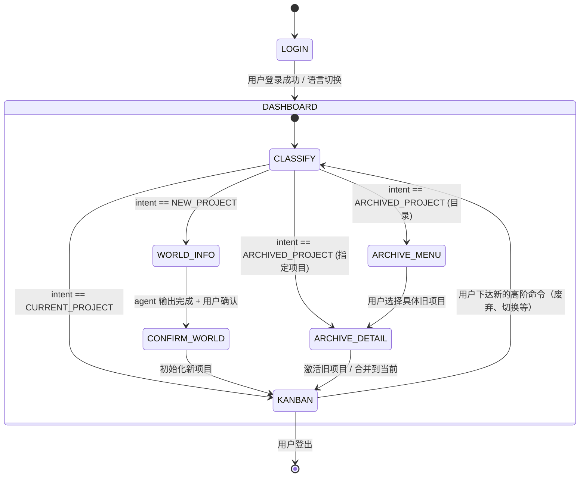
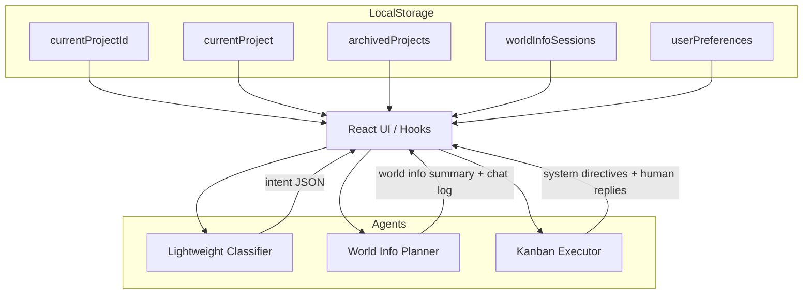

# AI Kanban System Overview · AI 看板系统总览

> 🇨🇳 说明：本 README 仍采用中英文对照形式，便于后续拆分为 `README.md`（中文）与 `README.en.md`（英文）。

## What this project is building · 项目愿景

This repository contains an AI-assisted project management workspace that combines a Kanban board with multiple conversational agents. The goal is to orchestrate a lightweight classifier agent, a world-information ("world info") planning agent, and a Kanban execution agent so users can switch projects, confirm AI actions, and keep structured histories without losing context.

本仓库正在打造一个多 Agent 协同的 AI 看板工作台：通过轻量级判定 Agent、世界信息配置 Agent、看板执行 Agent 的协作，让用户能够在不同项目之间切换、确认 AI 操作，并保持结构化的数据历史。

## Feature completion snapshot · 当前完成情况

| Area | Status | Notes |
| ---- | ------ | ----- |
| React entry point refactor | ✅ | `App.js` 已拆分为 orchestrator + 模块化子组件。|
| Workspace persistence | ✅ | 提供多项目数据结构骨架，支持本地存储读写与快照。|
| Project reset scaffolding | ✅ | 引入 `projectFlow` 状态机、确认弹窗钩子与世界信息界面切换逻辑。|
| Module documentation | ✅ | 核心模块提供双语注释，说明职责与未完事项。|
| Multi-language toggle | ⏳ | UI 预留多语言切换位，尚未接入 `i18n` 工具链。|
| Agent prompt library | ⏳ | 初步列出 prompt 层级，仍需实现正式模板与版本管理。|
| Old project revival UX | ⏳ | 数据结构已预留 `archivedProjects`，界面切换与动画待完成。|

## Known bugs & gaps · 已知问题与缺口

- 🔧 **Chat panels still share layout plumbing**：看板与世界信息的聊天在 UI 层仍存在耦合，需要根据项目 ID 完整隔离滚动、历史渲染与输入框状态。
- 🔧 **Agent confirmation loop incomplete**：轻量判定 Agent 目前仅在项目重置时触发，后续需要在每次关键命令前跑一遍，以确保多项目分类准确。
- 🔧 **Colour harmonisation**：AI 返回的颜色尚未映射到“中国传统色色系”方案，需在本地增加色板校正逻辑。
- 🔧 **User preference model empty**：`userPreferences` 占位字段尚未填充，影响个性化 prompt。

## Multi-agent focus · 多 Agent 协同重点

### 1. Roles & prompts · 角色与 Prompt 设计

| Agent | Responsibility | Prompt strategy |
| ----- | -------------- | --------------- |
| Lightweight classifier 轻量判定 Agent | 根据用户输入判定属于「新项目」「当前项目」「旧项目」（可扩展到“文字游戏”等模式）。 | 返回结构化 JSON：`{"intent":"NEW_PROJECT"|"CURRENT_PROJECT"|"ARCHIVED_PROJECT", "meta":{...}}`。 |
| World info planner 世界信息 Agent | 仅在新项目/重启项目时接管，引导头脑风暴、解析上传文件、补齐结构化项目信息。 | Prompt 强调无旧上下文、需生成完整世界信息摘要与确认提要。 |
| Kanban executor 看板 Agent | 管理日常任务、WIP、燃尽图、虚拟时间调整，并处理用户对旧项目的唤醒请求。 | Prompt 包含当前项目世界信息、近 5 条聊天、看板操控规则、用户习惯，要求输出人类回复与系统指令两部分。 |
| Internal brokers 内部协调 Agent | `kanbanOrchestrator`, `worldInfoBroker` 等内部脚本，负责验证 JSON、决定 UI 弹窗与数据迁移。 | 使用指令式模板，只输出机器可解析字段，不面向用户。 |

### 2. State transitions · 状态切换

### 3. Workspace layout · 数据结构

## End-to-end usage walkthrough · 用户使用流程

1. **Login & language selection 登录与语言切换**  
   用户打开应用后进入登录界面，可切换中英等语言。登录成功即进入看板聊天界面。
2. **Initial command -> classifier 首次指令走轻量判定**  
   所有高阶指令（新项目 / 当前项目 / 旧项目）先由轻量 Agent 分类；若未来扩展“文字游戏”等功能，可在 JSON 中预留字段。
3. **New project -> world info 新项目流程**  
   - 轻量 Agent 判定为 `NEW_PROJECT` 时，触发世界信息配置界面。
   - 世界信息 Agent 引导头脑风暴或解析上传的计划书，补齐项目结构化信息（目标、阶段、依赖、截止时间等）。
   - 完成后弹出确认弹窗，展示 Agent 整理的摘要，用户确认即保存并返回看板。
4. **Hand-off to Kanban 交接至看板**  
   - 看板界面清空旧聊天，加载新世界信息与完整配置对话记录。
   - 看板 Agent 询问用户是由它自动生成初始看板还是用户手动创建；其响应包括人类可读文本与给系统的 JSON 指令。
   - 若 AI 生成初始任务，将通过增量补丁写入任务列，再次弹窗确认。
5. **Daily operations 日常操作**  
   - 每次重要命令（如废弃项目、切换旧项目、合并项目）都先通过轻量 Agent 判定。
   - 看板 Agent 的 Prompt 持续包含：阻塞信息、当前任务列、世界信息摘要、用户习惯（占位）、操控规则、最近聊天片段。
6. **Project completion or abandon 项目完成/废弃**  
   - 用户表达“完成”或“不做了”时，轻量 Agent 识别为 `NEW_PROJECT` 流程，触发二次确认和世界信息重置。
   - 世界信息配置完成后回到看板，旧对话与任务被清空，但保留归档，可在未来唤醒。
7. **Reviving archived projects 唤醒旧项目**  
   - 轻量 Agent 判定为 `ARCHIVED_PROJECT`。若用户仅提到“给我旧项目列表”，则跳转到旧项目目录界面；若指明具体名称，直接载入对应看板。
   - 用户确认继续时，旧项目成为当前项目；若仅查看后退出，则保持现状。
   - 合并项目通过本地 UI 封闭式提问与关键词判断，无需 AI 参与。
8. **Colour management 颜色管理**  
   - 看板 Agent 返回的配色将映射到预设的中国传统色板，确保视觉一致性。

## Implementation roadmap · 实施路线图

1. **Finalize classifier loop**：将轻量判定 Agent 接入所有高阶命令入口；记录判定日志用于调试。  
   **完成后更新 README：** 添加判定覆盖率与示例 JSON。
2. **World info session isolation**：构建全新 UI 容器、清空旧聊天、实现上传解析与头脑风暴模式切换。  
   **完成后更新 README：** 附上字段校验列表与成功示例。
3. **Kanban reboot handshake**：实现世界信息 -> 看板的 prompt 交接、初始任务生成确认、虚拟时间同步入口。  
   **完成后更新 README：** 说明初始任务生成策略与用户覆盖选项。
4. **Archived project explorer**：实现目录视图、旧项目动画切换、合并流程；补齐 `archivedProjects` schema。  
   **完成后更新 README：** 发布旧项目唤醒 UX 截图与数据结构示例。
5. **i18n integration & UI polish**：导入 `i18next`，实现主题色映射、组件美化与可视化（燃尽图、CDF、WIP 等）优化。  
   **完成后更新 README：** 更新多语言配置方法与设计指引。

## Build log · 构建记录

- 2025-05-28 · Step 3：整理多 Agent 工作流、补充状态图与数据图，归档已知缺口，并删除过时 FAQ。
- 2025-05-28 · Step 2：引入 `projectFlow` 状态机与项目快照机制，接管“废弃项目 → 世界信息重置 → 回到看板”的流程开端。
- 2025-05-28 · Step 1：为 `src/app/**` 与 `src/components/**` 关键文件补充模块级注释，明确已完成功能、实现方式与待办事项。

如需进一步讨论实现细节或测试策略，欢迎继续提出要求。下一次完成关键节点时，请记得同步更新本文档，保持团队共享认知。
